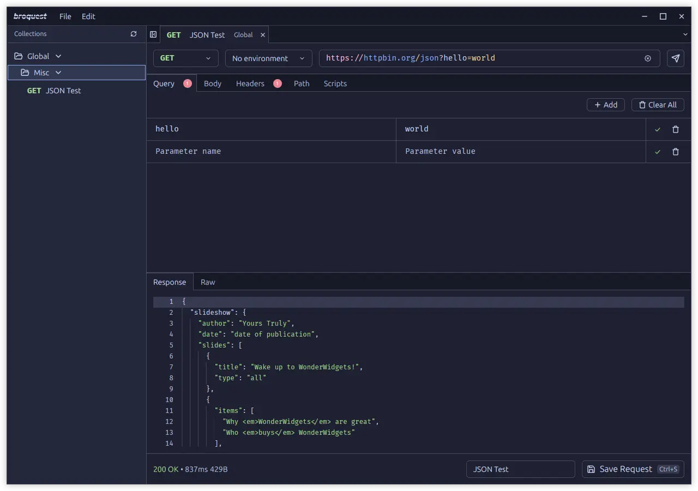

<picture>
  <source media="(prefers-color-scheme: dark)" srcset="docs/images/logo-dark.png">
  <source media="(prefers-color-scheme: light)" srcset="docs/images/logo-light.png">
  
</picture>
<hr><br>

A modern, desktop API client built with [GPUI](https://www.gpui.rs) and [gpui-kit](https://github.com/longbridge/gpui-kit), offering fast performance and a clean interface for API development and testing.



## Features

- **Native Performance** - Built with Rust and GPUI for fast native performance
- **File-based Storage** - Collections and configurations stored in human-readable TOML files
- **Environment Management** - Support for multiple environments with variables and secrets
- **JavaScript Scripting** - Pre-request and post-response scripting using QuickJS
- **Modern UI** - Clean, responsive interface with theme support, including VS Code color themes installed from [Open VSX](https://open-vsx.org) in Settings, Appearance
- **Local-first** - All your data stays on your machine with no cloud dependencies
- **Cross-platform** - Available for Linux, macOS and Windows

## macOS

Install with [Homebrew](https://brew.sh):

```bash
brew install --cask zanmato/tap/broquest
```

**IMPORTANT:** If you download the release manually you have to run `xattr -r -d com.apple.quarantine Broquest.app` in the folder of the app since the app isn't notarized.

## Nix

The repository is a flake for x86_64 and aarch64 Linux. It builds Broquest from
source, so the first install compiles for a while.

```bash
nix run github:zanmato/broquest                  # try it
nix profile install github:zanmato/broquest      # install it
```

On NixOS, add the flake as an input and `broquest.overlays.default` to
`nixpkgs.overlays`, then add `pkgs.broquest` to `environment.systemPackages`.
That builds Broquest against your system's own libraries.

Broquest draws with Vulkan. NixOS provides the driver, but with Nix on another
distribution a Nix-built program cannot load the system's driver, so start it
through [nixGL](https://github.com/nix-community/nixGL).

## .http files

Open a folder of `.http` or `.rest` files, as used by the JetBrains HTTP
Client and the VS Code REST Client, with Open Collection. Each file shows as
a group of its requests, and `@name = value` lines in a file apply to every
request in it. Environments come from `http-client.env.json` and
`http-client.private.env.json`, or from `rest-client.environmentVariables` in
`.vscode/settings.json`.

Pre-request scripts (`< `) and response handlers (`> `), inline or
from a file, run with the JetBrains `client`, `request` and `response` API.
Variables set with `client.global.set` or `request.variables.set` last for
the session. Requests can use an earlier response with VS Code style
references such as `{{login.response.body.$.token}}`.

`< ./file` lines in a body, multipart parts included, send that file when the
request is sent, and `<@ ./file` (VS Code) sends its text with variables
filled in. Comment lines in a body are sent as they are.

These directives work before a request line:

| Directive | Effect |
|---|---|
| `# @name login` | Names the request |
| `# @prompt username [description]` | Asks for a value before sending. Names like `password` are masked |
| `# @note [text]` | Asks for confirmation before sending |
| `# @no-redirect` | Does not follow redirects |
| `# @timeout 5s` | Sets the request's timeout, in `ms`, `s` or `m` |
| `# @no-log` | Leaves the request out of the history |

`>> ./response.json` after a request saves its response, next to an existing
file of that name, and `>>! ./response.json` overwrites it.
`{{$dotenv NAME}}` reads `NAME` from the `.env` file in the `.http` file's
folder. Authorization headers can use the VS Code shorthands `Basic user:password`,
`Basic user password` and `Digest user password`.

The collection reloads when its files change, so edits made in another
editor show up right away.

Saving writes requests back into their files, changing only what was
edited, so comments, blank lines and the rest of the file stay as they
were. New requests are added at the end of their file, and groups are
files: creating, renaming or deleting a group does the same to its file.
Basic, Digest and API key auth are saved as headers. Environments are saved
to `http-client.env.json`, with values that came from
`http-client.private.env.json` kept there. Environments that come from
`.vscode/settings.json` can't be saved yet.

## OAuth2

The Auth tab supports the client credentials and authorization code grants.
A request fetches a token when it is sent without a valid one, uses the
refresh token when the token expires, and fetches a new one once when the
server answers 401. Get Token and Clear Token do the same by hand, also in a
collection's Auth tab, where they use the collection's default environment.

- **Authorization code** opens the browser and listens for the redirect on
  127.0.0.1. With the redirect URL left empty that is
  `http://127.0.0.1:41983/callback`, which you register with the provider as
  an allowed redirect URL. Set another, such as
  `http://localhost:8080/callback`, if the provider has one registered
  already, or one with port 0 for a free port when the provider allows any
  loopback port. Cancel stops waiting, for example when the provider
  refuses the redirect URL. PKCE (S256) is a switch, and the client secret can then be
  empty. The `state` is random unless you set one, and it is checked.
- **Token request** sends the client ID and secret in the body or as a Basic
  auth header, and extra fields such as `audience`. A refresh URL can be set
  apart from the token URL.
- **Sending the token**: the access token, the ID token or both, in a header
  and with a prefix of your choice, such as `X-Auth: JWT <token>`.
- **Tokens** are kept while Broquest runs, per collection and environment.
  Requests with the same settings share one, and a token ID keeps a separate
  one.

## Built in variables

Requests can use `{{$...}}` variables that make a new value every time they
are sent. The names from the VS Code REST Client, the JetBrains HTTP Client
and Postman all work, so imported requests keep their meaning.

| Variable | Value |
|---|---|
| `{{$guid}}`, `{{$uuid}}`, `{{$randomUUID}}` | A random UUID |
| `{{$nanoid}}`, `{{$nanoid 10}}` | A random URL safe id |
| `{{$timestamp}}`, `{{$timestampMs}}` | Unix time in seconds or milliseconds |
| `{{$isoTimestamp}}` | The current UTC time in ISO 8601 |
| `{{$datetime iso8601}}`, `{{$datetime rfc1123}}` | The current UTC time |
| `{{$localDatetime "YYYY-MM-DD HH:mm"}}` | Local time in a [day.js style format](https://day.js.org/docs/en/display/format) |
| `{{$date}}`, `{{$today}}`, `{{$tomorrow}}`, `{{$yesterday}}` | A local date as `YYYY-MM-DD` |
| `{{$randomInt}}`, `{{$randomInt 1 7}}`, `{{$random.integer(1, 7)}}` | A random integer, the upper bound left out |
| `{{$random.float(0, 1)}}` | A random number |
| `{{$randomDigits 4}}`, `{{$randomZipCode}}` | Random digits |
| `{{$random.alphabetic(8)}}`, `{{$random.alphanumeric(8)}}`, `{{$random.hexadecimal(8)}}` | A random string |
| `{{$randomEmail}}`, `{{$randomFirstName}}`, `{{$randomLastName}}`, `{{$randomFullName}}`, `{{$randomCity}}`, `{{$randomPhoneNumber}}`, `{{$randomWord}}`, `{{$randomBoolean}}` | Example data |
| `{{$processEnv HOME}}` | An environment variable of the Broquest process |

Time based variables take an offset: `{{$timestamp -1 d}}`,
`{{$date -1 w}}` or `{{$datetime iso8601 2 h}}`, in the units
`y M w d h m s ms`.

## Scripting

Broquest supports JavaScript scripting for pre-request and post-response hooks using [QuickJS](https://bellard.org/quickjs/) with [LLRT modules](https://github.com/awslabs/llrt) that provide Node.js-compatible APIs.

### Available Objects

#### `req` Object (Pre-request scripts)

The `req` object contains the current request data that can be modified before sending:

```javascript
// Request method (GET, POST, etc.)
req.method;

// Request URL
req.url;

// Request body
req.body;

// Headers object (read/write)
req.headers["Content-Type"] = "application/json";
req.headers.Authorization = "Bearer token";

// Query parameters object (read/write)
req.query.page = "1";
req.query.limit = "10";
```

#### `res` Object (Post-response scripts)

The `res` object contains the response data:

```javascript
// Response status code (200, 404, etc.)
res.status;

// Response status text ("OK", "Not Found", etc.)
res.statusText;

// Response body (string, or object if JSON)
res.body;

// Response headers object (read-only)
res.headers["content-type"];
res.headers["server"];

// Response latency in milliseconds
res.latency;

// Response size in bytes
res.size;
```

#### `bro` Object

The `bro` object provides utility functions for environment variables and notifications:

```javascript
// Set environment variable
bro.setEnvVar("API_KEY", "your-api-key-here");

// Get environment variable (returns undefined if not found)
bro.getEnvVar("API_KEY");

// Show a toast in the app when the request finishes. The type is "info"
// (the default), "success", "warning" or "error". A request shows at most
// five, and they show even when a script or the request fails afterwards.
bro.notify("Token refreshed");
bro.notify(`Got ${res.body.items.length} items`, "success");

// Forget the request's OAuth2 token, so the next send fetches a new one.
bro.resetOAuth2Token();
```

#### Global Functions

##### Base64 Encoding/Decoding

```javascript
// Encode to base64
const encoded = btoa("hello world");

// Decode from base64
const decoded = atob("aGVsbG8gd29ybGQ=");
```

##### Crypto Operations

```javascript
// Generate UUID v4
const id = crypto.randomUUID();

// Create hash
const hash = crypto.createHash("sha256").update("data").digest("hex");
```

##### URL Operations

```javascript
// Parse URLs
const url = new URL("https://api.example.com/users/123?active=true");

// URL search parameters
const params = new URLSearchParams("?name=John&age=30");
params.append("city", "NYC");
params.get("name");
```

### Script Examples

#### Basic Authentication

```javascript
// Pre-request script for Basic Auth
req.headers.Authorization =
  "Basic " +
  btoa(`${bro.getEnvVar("merchantid")}:${bro.getEnvVar("password")}`);
```

#### Dynamic Headers

```javascript
// Pre-request script to set timestamp and signature
const timestamp = Date.now();
const payload = req.method + req.url + req.body + timestamp;

// Simple hash example (use crypto.createHash for real hashing)
const signature = crypto.createHash("sha256").update(payload).digest("hex");

req.headers["X-Timestamp"] = timestamp.toString();
req.headers["X-Signature"] = signature;
```

## Website

The site at <https://zanmato.github.io/broquest> is built from `site/` with
`script/build-site` and published by the release workflow.

Its screenshots in `docs/images/screenshots` come from
`script/screenshots/capture`. The script builds Broquest with the `screenshots`
feature and runs it on a virtual X display against a throwaway data directory,
a demo collection and a local demo API, so nothing from your own profile or
keychain shows up. It needs Xvfb, ImageMagick, python3, dbus-run-session and
Mesa's lavapipe Vulkan driver.

## License

Apache-2.0

- Icons from [Lucide](https://lucide.dev).
